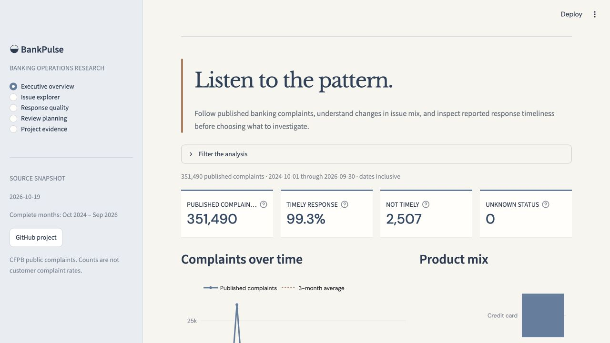
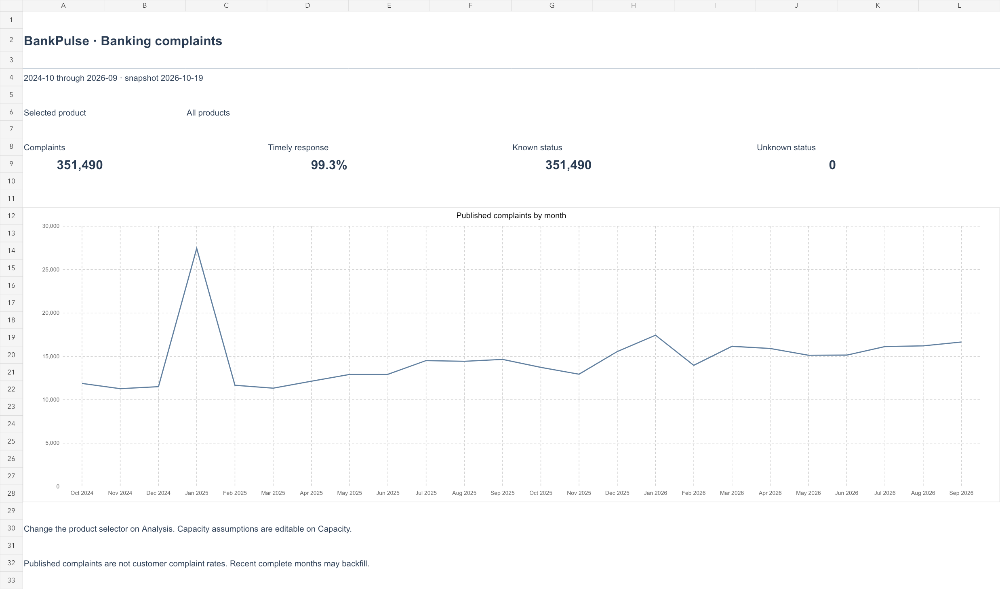
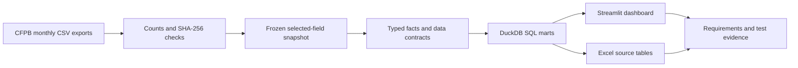

# BankPulse
### Banking complaints & service quality analytics

**[Open the live dashboard](https://bankpulse-vidya.streamlit.app/)** · Runs in your browser; no installation required.

**A finance analytics case study connecting public data, business requirements, Excel analysis, and user acceptance testing.**

BankPulse helps a fictional banking operations team decide which complaint patterns deserve investigation and estimate the effort required to review selected records. It uses **351,490 published complaints across 24 complete months**, with a separate view of the current partial month.



[Download Excel workbook](excel/BankPulse.xlsx?raw=true) · [Findings](docs/findings.md) · [User stories](docs/requirements.md) · [UAT scripts](docs/uat_cases.csv) · [Dashboard tour](docs/demo.md)

## What the project demonstrates

| Skill | Evidence |
|---|---|
| Business analysis | Four simulated personas, 12 prioritized user stories, acceptance criteria, process flow, scope boundaries |
| UAT design | 24 executable scenarios, requirement traceability, actual/expected results, reviewer fields, defect register |
| Excel | SUMIFS, COUNTIFS, XLOOKUP, weighted KPIs, scenario inputs, validation, conditional formatting, charts, PivotTable and slicer package parts |
| SQL & data engineering | Monthly API acquisition, source hashes, typed facts, DuckDB marts, data contracts, offline reproducibility |
| Analysis & visualization | Intersecting filters, complete-month trends, change-contribution waterfall, explicit denominators, review capacity simulation |
| Quality assurance | Automated regression tests, workbook reconciliation, browser checks, GitHub Actions |

## Five workspaces

1. **Executive overview:** product, company, state and date filters; volume, response timeliness, monthly trend and product mix.
2. **Issue explorer:** compare complete months, reconcile issue contributions to net change, and apply transparent review thresholds.
3. **Response quality:** inspect reported responses and company-level denominators, then export matching records.
4. **Review planning:** select explicit not-timely records and model weekly capacity with editable assumptions.
5. **Project evidence:** source provenance, quality controls, Excel workbook, requirements and UAT downloads.

## A few findings

- September 2026 had **16,651** published complaints, up **450 (2.78%)** from August.
- Statement-purchase issues contributed **156** of that increase; account closing contributed **119**. These are observations to investigate, not causal explanations.
- The complete-period timely-response share was **99.2868%**, calculated from 348,983 Yes records / 351,490 known statuses.
- September contained **40** records explicitly marked not timely. The illustrative default staffing assumptions yield capacity for **60** reviews per week.

See [the research brief](docs/findings.md) for interpretation, suggested follow-up and limits.

## Excel deliverable

The [nine-sheet workbook](excel/BankPulse.xlsx?raw=true) contains a linked executive view, full-population monthly analysis, a capacity model, Pivot Analysis, a labeled 500-record detail extract, source aggregates, lookups, a UAT register and a guide. Amber cells are editable.



The workbook includes product selection, scenario inputs, linked charts and source reconciliation. See [workbook details and validation status](excel/README.md).

## Run locally

Python 3.13 is the reference environment. The frozen public-data snapshot and processed results are included; an API key is not required.

```bash
git clone https://github.com/vidyacheekuri/bankpulse.git
cd bankpulse
python -m venv .venv
source .venv/bin/activate
pip install -r requirements.txt
python -m bankpulse.pipeline
python -m pytest -q
python -m streamlit run app.py
```

On Windows, activate with `.venv\Scripts\activate`. Streamlit displays the local URL after launch. GitHub hosts the source and downloadable artifacts. Use the [public dashboard](https://bankpulse-vidya.streamlit.app/) for browser access, or the commands above for local development.

For a container: `docker build -t bankpulse .`, then `docker run --rm -p 8501:8501 bankpulse`.

## Data and reproducibility

Source: [CFPB Consumer Complaint Database](https://www.consumerfinance.gov/data-research/consumer-complaints/), retrieved **2026-10-19**. Products: Credit card; Checking or savings account. Complete analysis: **October 2024–September 2026**. An additional **3,253** partial-October records are retained separately.



- [Source manifest](data/source_lock.json): exact query URLs, partition counts and hashes.
- [Data dictionary](docs/data_dictionary.md) and [methodology](docs/methodology.md): field and metric definitions.
- [SQL research questions](sql/research_questions.sql): reproducible analysis examples.
- [Quality report](reports/quality.json), [developer validation](docs/verification.md), [traceability matrix](docs/traceability.md).

`python -m bankpulse.pipeline` rebuilds from the committed snapshot without network access. `python -m bankpulse.ingest` performs a new acquisition; inspect its configuration and preserve the existing snapshot before intentionally refreshing. Source data can backfill, so a later acquisition may differ.

## Honest scope

Public complaints are not a representative customer survey, incidence rates, market share, regulatory findings or a live unresolved backlog. Response timeliness is the source Yes/No field; dates sent to a company do not establish resolution time. Staffing and review-team mappings are simulated. The newest 500 workbook records are a demonstration extract, not a representative sample.

Human UAT cases remain **Not run** until a reviewer executes and signs them off. Automated developer checks do not substitute for stakeholder acceptance. No business savings, stakeholder interviews or production deployment are claimed.

Code is available under the [MIT License](LICENSE). Public source data remains attributed to CFPB; no CFPB endorsement is implied.
