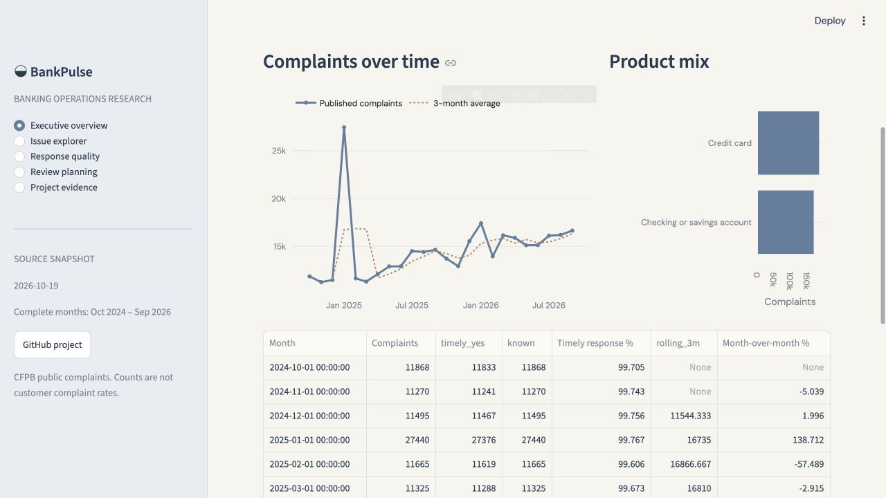
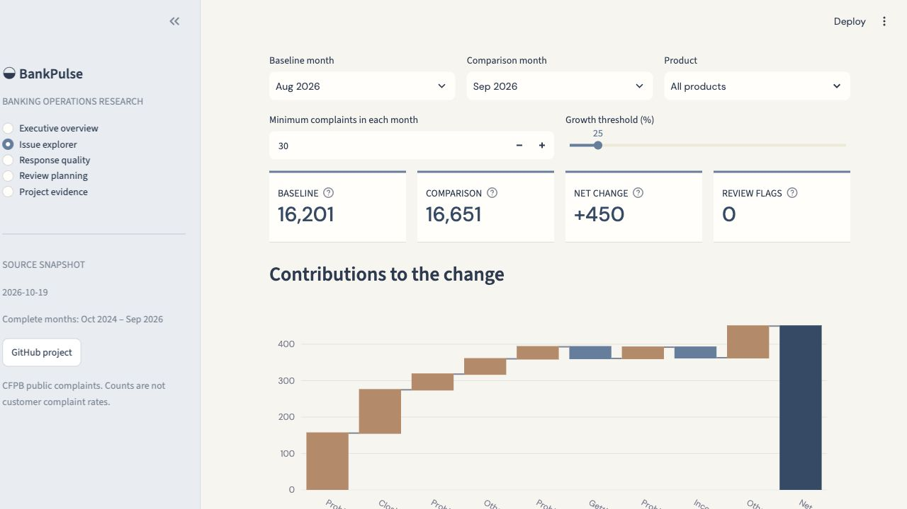
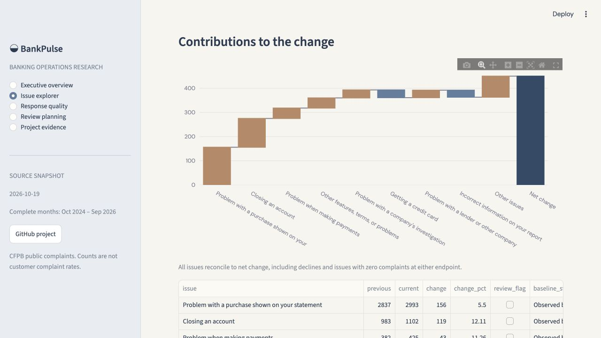
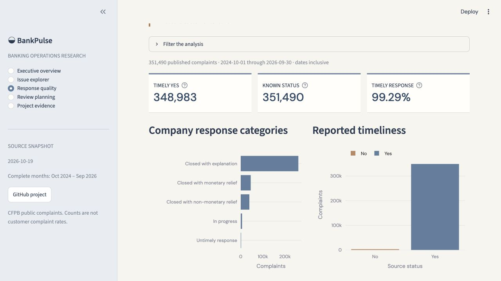
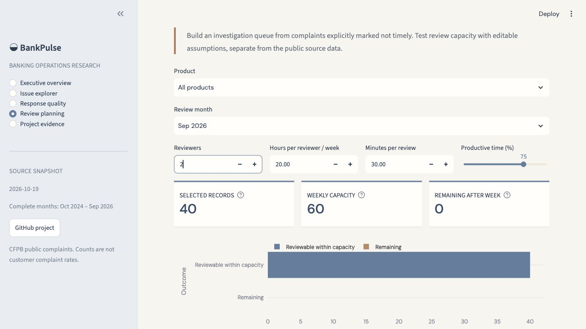
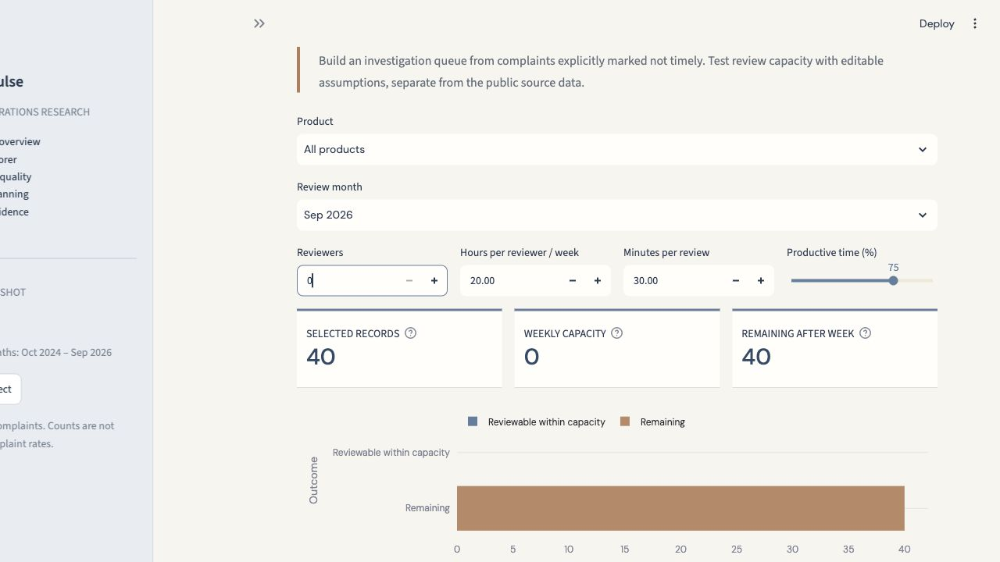
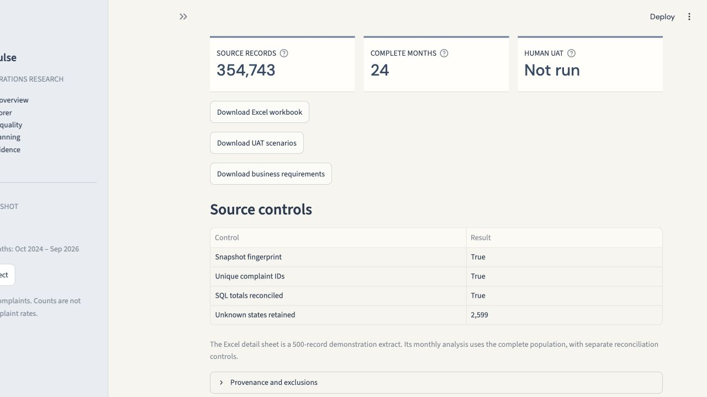

# BankPulse dashboard tour

This screenshot tour shows the delivered application. Run it with the instructions in the main README to interact with its filters and exports.

## 1 · Start with the complete population

The overview keeps the source snapshot and calendar range visible. Compare product mix and the monthly series before drilling into a change.

## 2 · Explain a change

The issue explorer compares August and September 2026 by default: +450 complaints. Its waterfall includes both increases and decreases, with other issues grouped so the total still reconciles. Threshold flags are explicit screening rules.

## 3 · Inspect the response denominator

Reported timeliness uses Yes divided by Yes plus No. Unknowns are separate, company counts supply context, and company size is not inferred.

## 4 · Test an assumption

The review workspace starts with 40 historical September records explicitly marked not timely. Two reviewers yield capacity for 60 reviews under the displayed assumptions. Setting reviewers to zero leaves all 40 records remaining.

## 5 · Inspect the evidence

Download the workbook, requirements and acceptance scenarios. Human UAT remains Not run until a reviewer executes the scripts.

